# Airline Data Ingestion Project

---

## Project Overview

This project demonstrates an automated, event-driven airline data ingestion pipeline built using AWS services.

The pipeline processes daily flight data uploaded to Amazon S3, uses AWS Glue for data discovery and ETL processing, and loads the transformed data into Amazon Redshift for further analysis.

The workflow is orchestrated using AWS Step Functions and Amazon EventBridge. Amazon SNS is used to send email notifications when the workflow completes successfully or encounters an issue.

**Technologies Used:** Amazon S3, AWS Glue, Amazon Redshift, Amazon EventBridge, AWS Step Functions, Amazon SNS, and AWS IAM.

---

## Architectural Diagram

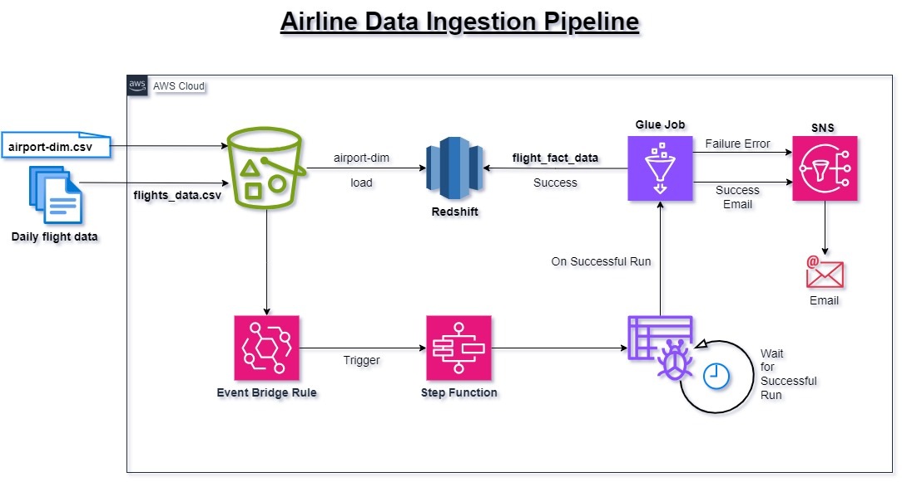

---

## Key Steps

### 1. Create an Amazon S3 Bucket

- Create an S3 bucket named `airline-data-input` to store the airport dimension file and daily flight data files.

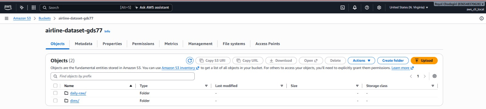

### 2. Create a Schema and Tables in Amazon Redshift

- Create a schema named `airlines` in Amazon Redshift.
- Create the following tables:
  - `airports_dim`
  - `daily_flights_fact`
- Load the airport dimension data from Amazon S3 into the `airports_dim` table.

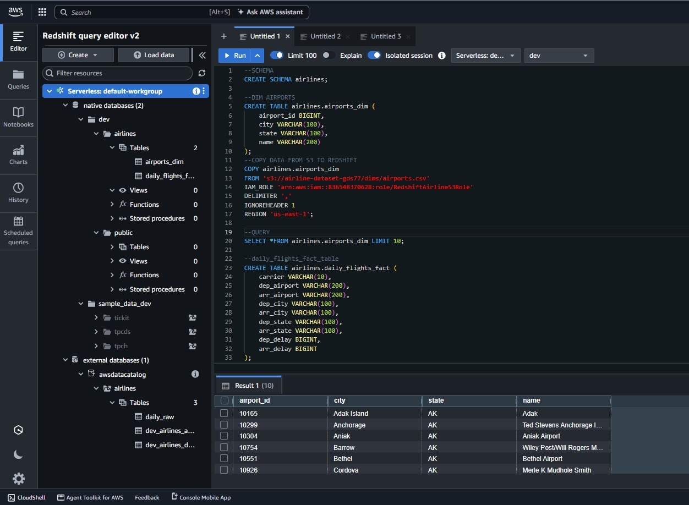

### 3. Create AWS Glue Crawlers for Redshift Tables

- Create AWS Glue crawlers to discover the Redshift tables and register their metadata in the AWS Glue Data Catalog.

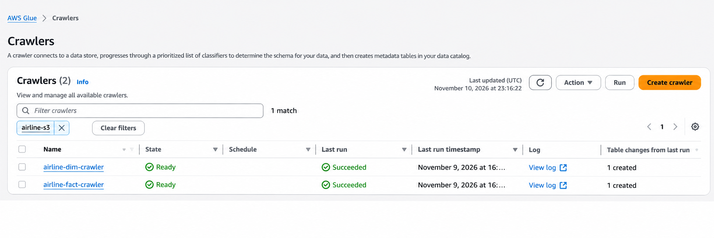

### 4. Create AWS Glue Crawlers for S3 Input Data

- Create a sample Hive-style folder structure in Amazon S3 and upload a sample data file to configure the crawler.
- Create and configure an AWS Glue crawler to discover the flight data stored in Amazon S3.
- Verify the discovered tables in the AWS Glue Data Catalog.

**S3 Input Data:**

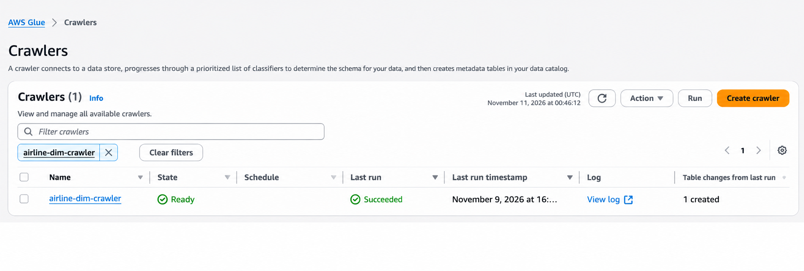

**S3 Glue Crawler:**

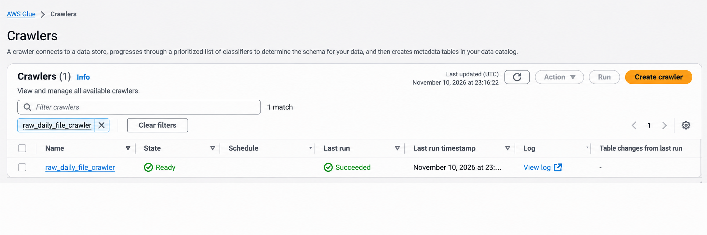

**Glue Data Catalog Tables:**

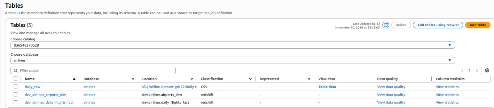

### 5. Create the AWS Glue ETL Pipeline

- Create an AWS Glue ETL pipeline named `flight-data-ingestion-pipeline`.
- Join the daily flight data with the airport dimension data.
- Transform the data and generate a denormalized dataset for further analysis.

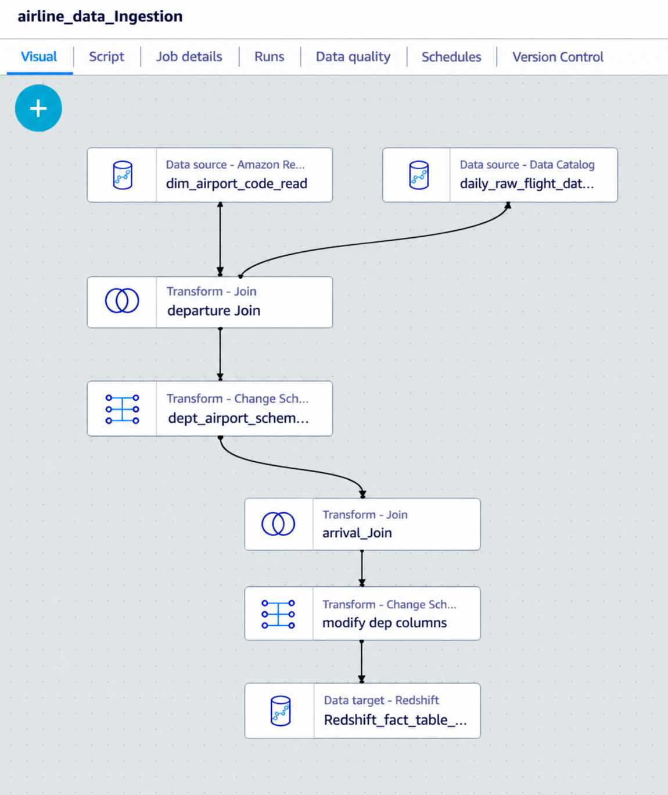

### 6. Configure Amazon SNS Notifications

- Create an Amazon SNS topic named `glue-job-notification`.
- Subscribe your email address to the topic to receive workflow notifications.

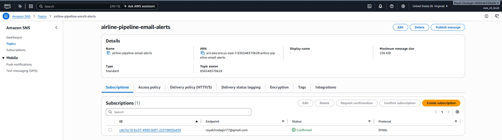

### 7. Create a State Machine Using AWS Step Functions

- Create a state machine using AWS Step Functions.
- Configure the workflow to coordinate the Glue crawler, ETL job execution, and SNS notifications.

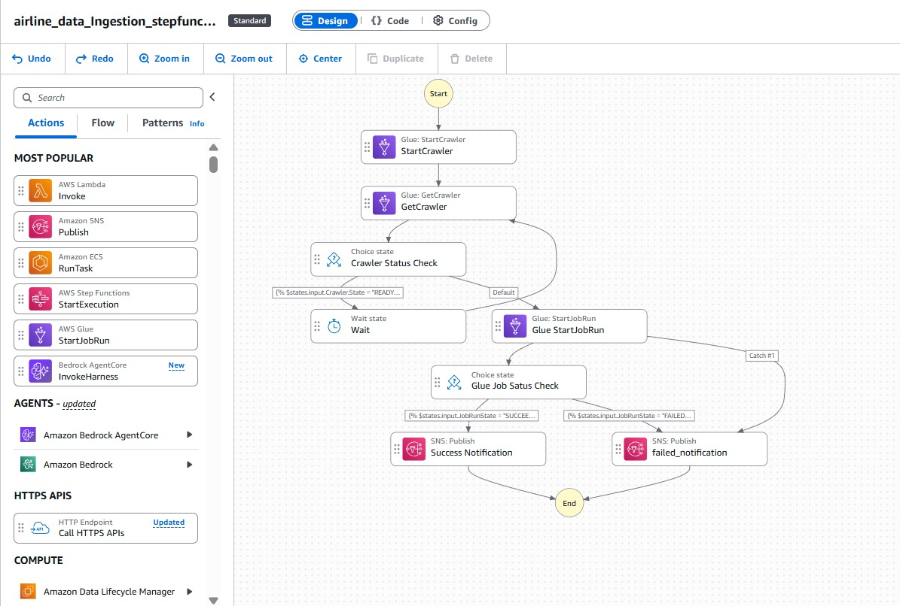

### 8. Create an Amazon EventBridge Rule

- Create an EventBridge rule named `Airline-S3-StepFunc-EventRule`.
- Configure the rule to detect object creation events in the airline data S3 bucket.
- Set the rule to trigger the Step Functions state machine when a new object is uploaded.

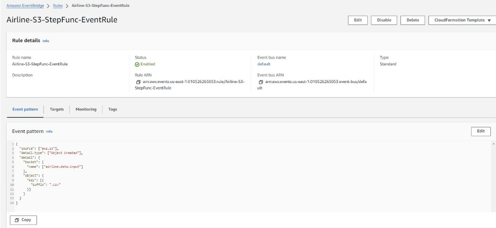

### 9. Upload the Daily Flight Data

- Upload the daily flight data CSV file to the input S3 bucket.
- The S3 object creation event triggers the EventBridge rule, which starts the Step Functions workflow.

**S3 File Upload:**

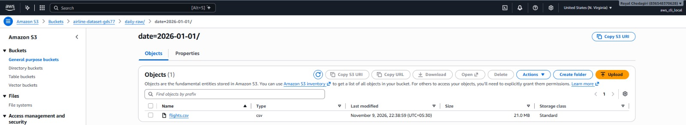

**AWS Glue Job Execution:**

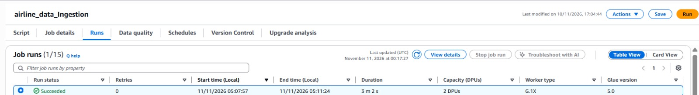

**Step Functions Execution:**

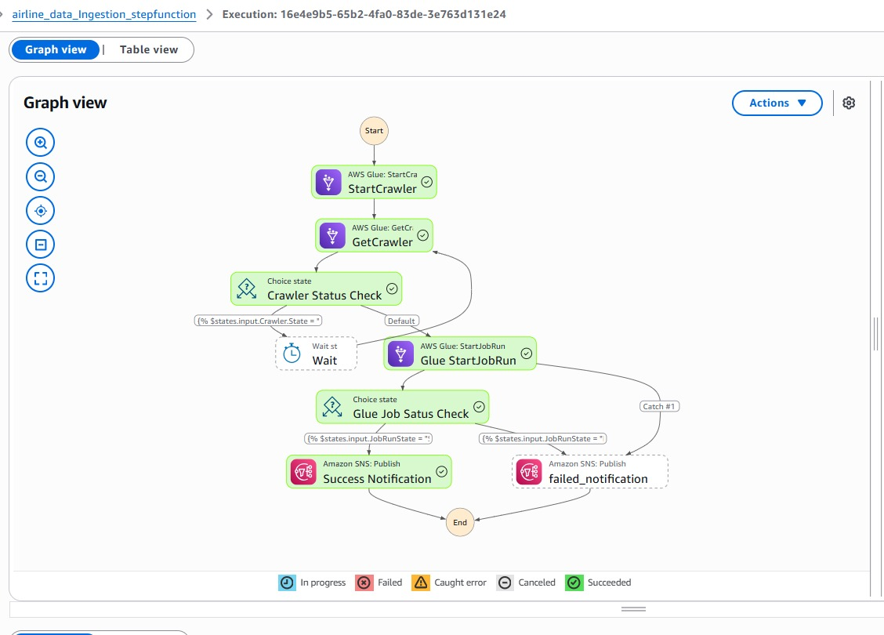

### 10. Verify the Output

- Check your subscribed email inbox for the successful workflow notification.
- Verify that the transformed flight data has been loaded into the Amazon Redshift fact table.

**Email Notification:**

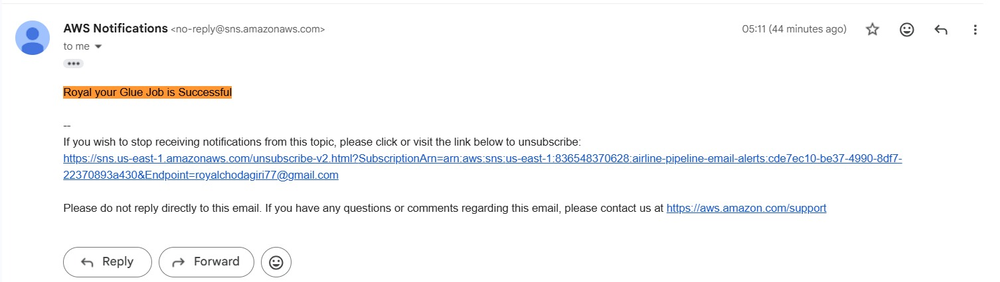

**Final Data in Redshift:**

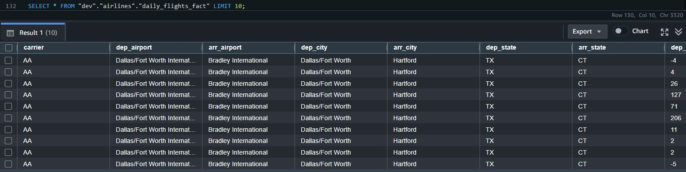
